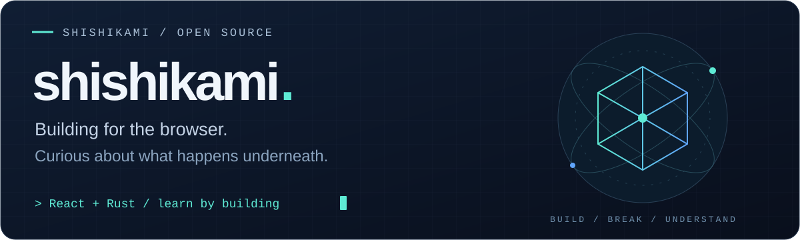
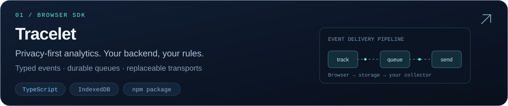
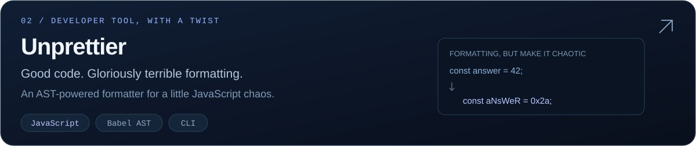
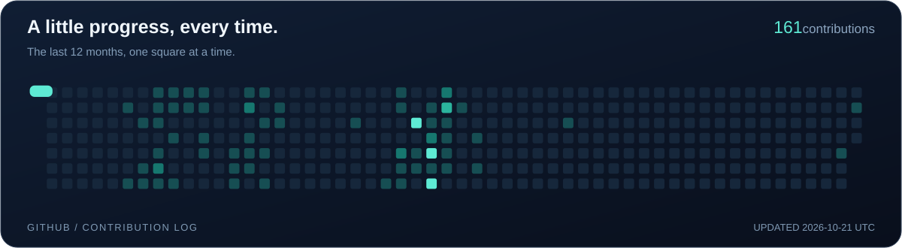

  

  <a href="#selected-work">Selected work</a> &nbsp; / &nbsp;
  <a href="https://tracelet-opal.vercel.app/playground">Tracelet playground</a> &nbsp; / &nbsp;
  <a href="mailto:2428076728@qq.com">Say hello</a>

I build things for the browser and learn by making them. Currently exploring **React** and **Rust**, with a soft spot for developer tools and the details under the hood.

### Selected work

[Playground](https://tracelet-opal.vercel.app/playground) · [Documentation](https://tracelet-opal.vercel.app/quickstart) · [npm](https://www.npmjs.com/package/tracelet-browser)

[Source code](https://github.com/shishikami/Unprettier) · [npm](https://www.npmjs.com/package/unprettier)

### Tools & curiosity

| Building with | Also in the toolkit | Exploring |
| :--- | :--- | :--- |
| React · Vue · TypeScript · JavaScript | Node.js · Python · Spring Boot | Rust |
| HTML · CSS | MySQL · Redis · SQLite | How things work underneath |

### Commit by commit

Build something useful. Have a little fun along the way.

<!-- Contribution animation: https://github.com/Platane/snk -->
